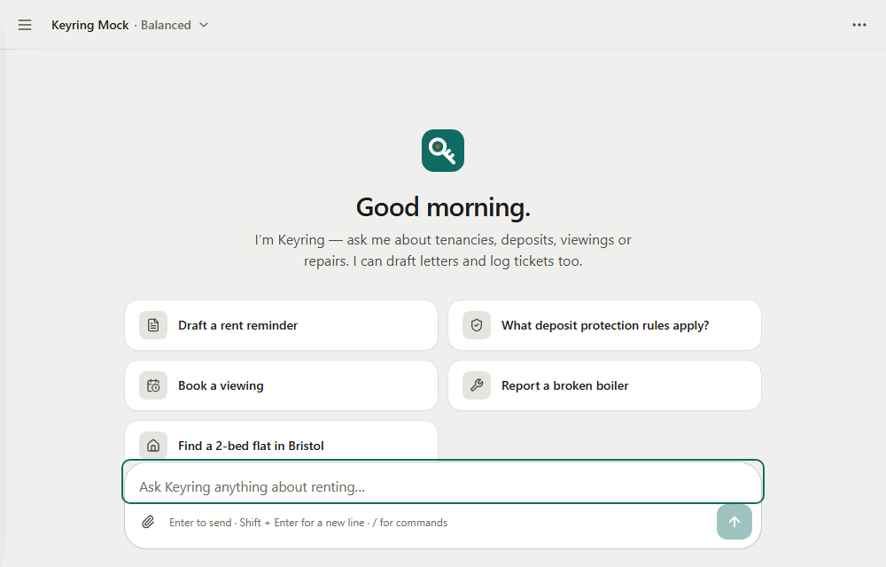
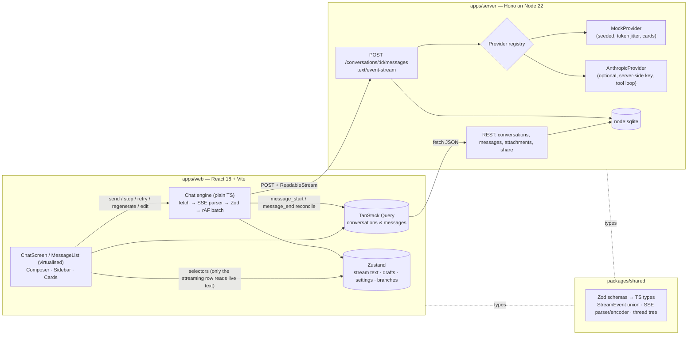

# Keyring — an AI lettings assistant (streaming chat UI)

> **Fictional product.** Keyring is an invented assistant for UK tenants, landlords and letting agents. All names, listings and addresses are made up. Answers are general information, not legal advice.

A portfolio-grade chat interface built with **React 18 + Vite + TypeScript (strict)**. It streams replies token by token over **SSE**, renders **sanitised Markdown** with **Shiki** code blocks, shows **structured tool-result cards**, and handles every awkward state a real AI chat hits: stop, retry mid-stream, regenerate, edit-and-resend branches, offline, rate limits.

It runs free out of the box against a built-in **mock streaming server**. Set `ANTHROPIC_API_KEY` on the server to plug in a real model; the key never reaches the browser.



**Live demo:** https://ai-lettings-assistant.vercel.app · **API:** https://keyring-api.onrender.com/health · **Playground:** https://ai-lettings-assistant.vercel.app/playground

> The API runs on Render's free tier and sleeps when idle — the first request after a while can take ~50 s to wake it.

---

## Highlights

| | |
| --- | --- |
| **Streaming** | `fetch` + `ReadableStream` + `TextDecoder` + a hand-written, spec-compliant SSE parser. Typed events (Zod), rAF-batched rendering, AbortController stop, resume-after-failure that keeps partial text. |
| **Messages** | Markdown (GFM tables, lists, links in a new tab), Shiki highlighting with copy, inline cards (property, viewing-slot picker, maintenance ticket), copy / regenerate / edit-and-resend (branches with `‹ 2/3 ›`), 👍/👎. |
| **States** | sending · streaming · stopped (Continue) · network drop mid-stream (Retry resumes) · provider error · server 500 · rate limited (countdown) · offline banner + auto-resume on reconnect. A demo menu can trigger each one live. |
| **Composer** | Auto-grow, Enter / Shift+Enter, **IME-safe**, char counter, Stop replaces Send, drag & drop / paste images & PDFs with previews, validation and real upload progress, `/` slash commands (ARIA listbox), drafts saved per chat. |
| **Sidebar** | Today / Yesterday / Previous 7 / 30 days / Older, pinned on top, server search, inline rename (F2), pin, **delete with Undo** (server soft-delete), infinite scroll, mobile drawer. |
| **Scroll** | Sticks to the bottom only if you're already there; scroll up and it leaves you alone and shows *Jump to latest*. Always virtualised (600 messages ≈ 7 DOM rows). |
| **A11y** | `role="log"`, completed replies announced once (never per token), full keyboard use, focus returns to the composer, visible focus, axe-clean (WCAG 2.2 AA) in **both themes**. |
| **Other** | Light/dark/system theme, text size, reduced motion, keyboard shortcuts dialog, read-only share links (`/share/:id`), visualViewport + safe-area handling for mobile keyboards. |

**Quality bar:** 75 unit/integration tests (Vitest + RTL), 15 Playwright tests (desktop, mobile, axe in both themes), Lighthouse desktop **100 / 100 / 100** (performance / accessibility / best practices), typecheck + lint clean in CI.

---

## Quick start

Requires **Node 22.12+** and **pnpm 9**.

```bash
pnpm install
pnpm dev          # API on :8787 (mock mode, seeded demo chats) + web on :5173
```

Open http://localhost:5173. Try the suggestion chips, `/viewing`, or **⋯ → Simulate on next reply** to see each error state.

| Command | What it does |
| --- | --- |
| `pnpm dev` | Server (tsx watch) + Vite, `/api` proxied (same origin, no CORS) |
| `pnpm test` | Vitest across `shared`, `server`, `web` |
| `pnpm e2e` | Playwright (spins up its own API + web on 8788 / 5174) |
| `pnpm typecheck` · `pnpm lint` · `pnpm build` | What CI runs |
| `pnpm seed -- --reset` | Re-create demo data (incl. a 600-message chat) |
| `node scripts/record-demo.mjs` | Re-record `docs/demo.gif` from the running app |

**Real model (optional):** copy `apps/server/.env.example` to `apps/server/.env` and set `ANTHROPIC_API_KEY`. *Claude Opus 5.5* then appears in the model menu next to *Keyring Mock* (still the default). Response style maps to effort: Fast→low, Balanced→medium, Thorough→high.

---

## Architecture



```
apps/web/src
  app/                 router, providers
  components/ui/       Button, Dialog (native <dialog>), Menu (portal, ARIA), Toaster, …
  features/chat/       ChatScreen, messages/, markdown/, cards/, scroll/, stream/ (engine + store + hook)
  features/composer/   Composer, attachments, slash commands
  features/conversations/  Sidebar, list item, queries & optimistic cache helpers
  features/playground/ /playground: every component × state × theme, replayable fake stream
apps/server/src
  routes/ (REST + SSE) · providers/ (mock, anthropic, fixtures) · db/ (migrations, repository, seed)
packages/shared/src
  schemas.ts · sse.ts · thread.ts
```

---

## How streaming works

1. **Request.** `POST /api/conversations/:id/messages` with `{ intent: "send" | "regenerate" | "resume", … }`. The server validates it with the shared Zod schema, creates the user and assistant rows, and answers `text/event-stream`.
2. **Events.** `message_start` (both messages) → `text_delta`… / `tool_result` (with the text offset where it belongs) → `message_end` (final message + updated conversation, e.g. the auto title) or `error` (typed code, `retryable`, `retryAfterMs`). Heartbeat comments keep proxies from closing idle connections.
3. **Why `fetch` and not `EventSource`.** `EventSource` is GET-only: no JSON body, no custom headers, and no HTTP status for showing a 429 vs a 500. It also reconnects on its own, which is wrong for a one-shot generation.
4. **Parsing.** `TextDecoder.decode(chunk, { stream: true })` handles UTF-8 split across chunks (`£`, `—`). The parser in `packages/shared/src/sse.ts` follows the WHATWG rules: CRLF / LF / CR, a CR at the end of one chunk with LF at the start of the next, comments, multi-line `data`, events split anywhere. Every event is Zod-validated; malformed events are skipped, not fatal.
5. **Rendering.** Deltas go into a buffer committed **once per animation frame** to a Zustand store. Only the streaming reply subscribes to that text, and every other row is memoised, so a 200-token reply in a 40-message chat costs **0** row re-renders. Markdown is split into blocks and only the last block re-parses.
6. **Stop / failure.** Stop aborts the fetch; the server sees the disconnect, stops the provider and saves the partial reply as `stopped`. A dropped connection or provider error leaves `error` with the partial text. **Retry/Continue resume the same message**: the server streams only the remainder, and the client keeps what it had.

## How I prevent XSS

- **Model text never becomes HTML.** There's no `rehype-raw`, and a small remark plugin turns raw HTML in model output into **plain text**, so `<script>` and `` show up verbatim and inert.
- **Defence in depth.** `rehype-sanitize` (GitHub's schema, tightened) still runs. URLs pass through an allow-list (`http(s)`, `mailto`, `#`, same-origin paths); `javascript:`, `data:` and protocol-relative URLs are dropped. External links get `target="_blank" rel="noopener noreferrer nofollow"`; Markdown images are not rendered.
- **One reviewed `dangerouslySetInnerHTML`:** Shiki's output, which escapes the code itself and only emits `<pre>/<span style>`.
- **Cards are data, not markup.** Tool results are Zod-validated JSON rendered by React components.
- **User text** is rendered as text (`white-space: pre-wrap`), never Markdown.
- **Uploads:** type allow-list with no SVG, size limit, server-side magic-byte sniffing, `X-Content-Type-Options: nosniff`, and a sandboxing CSP on served images.
- **Proof.** `Markdown.test.tsx` renders `<script>`, ``, `<svg onload>`, `javascript:`/`data:` links, iframes and inline styles, and asserts no executable element, handler or unsafe URL exists and nothing ran. The e2e test does the same against a real model reply in Chromium (no `alert`, `window.__xss` untouched).

---

## Challenges (and what I learned)

- **"Is the user at the bottom?" lies during streaming.** Growing content and virtual-row measurement fire scroll events that look like the user scrolling up. The fix: only *user-initiated* scrolls (wheel/touch/keys within 600 ms) can unpin; reaching the bottom always re-pins. I verified in Chromium that `scrollTop` doesn't move by a pixel while you read history during a stream.
- **A Stop/refetch race.** Refetching right after Stop could return the reply still marked `streaming`, leaving a row waiting for tokens forever. Now only the reply this tab is actually streaming renders live. The server also tracks in-flight replies, so an orphaned `streaming` reply can still be resumed.
- **Resume that's truly seamless.** The mock is seeded by the assistant message id, so a resumed reply regenerates the identical script and skips what was already sent. Tests assert the final text equals an uninterrupted run.
- **Menus under later siblings.** A transformed list item creates a stacking context, so later rows painted over its dropdown. Playwright caught it (the click was intercepted). Menus are now portalled with fixed positioning and flip when there's no room below.
- **Timezones.** Viewing slots showed 15:30 for a 10:00 UK viewing on a UTC+5:30 machine. UK property times now always render in `Europe/London`.
- **Contrast in syntax themes.** axe flagged a 4.46:1 keyword colour; switching to Shiki's `github-*-default` themes and a white code background fixed it in both themes.
- **Bundle cost.** Lighthouse started at Performance 74 (690 ms TBT). Lazy-loading the Markdown stack, which the empty state never needs, took it to 100 (20 ms TBT).
- **Native SQLite and bundlers.** tsup strips `node:` prefixes by default, and `sqlite` without the prefix doesn't exist. The production build crashed until `removeNodeProtocol: false` was set.

More reasoning in [DECISIONS.md](DECISIONS.md); conventions in [CONTRIBUTING.md](CONTRIBUTING.md); phases in [PLAN.md](PLAN.md).

---

## Testing

| Suite | Covers |
| --- | --- |
| `packages/shared` (19) | SSE parser: split events, many per chunk, CRLF/CR across chunks, comments, multi-line data, multi-byte UTF-8, malformed JSON / shape; thread-tree helpers |
| `apps/server` (14) | REST CRUD, cursor pagination + search, SSE event order, cards, branches, **drop mid-stream → resume yields identical text**, provider error, 500/429, attachment validation + sniffing, rate limiter |
| `apps/web` (42) | **XSS** payloads, safe URLs, Markdown block splitting; chat engine (batching, drops, malformed events, rate limits, stop); composer (Enter / Shift+Enter / **IME**, counter, Stop, slash menu, drafts); scroll pin logic; **optimistic delete + Undo** + rollback; date grouping; **render-count benchmark** |
| Playwright (15) | send → stream → **stop → continue → regenerate**; **drop mid-stream → Retry**; rate-limit countdown; edit-and-resend branches; XSS inert in a real browser; cards → book viewing → pick slot; rename + delete + Undo survives reload; shortcuts; **mobile** drawer flow + no horizontal overflow; **axe WCAG 2.2 AA in light and dark** |

CI (`.github/workflows/ci.yml`): typecheck, lint, unit tests and build, then Playwright against the production bundle and **Lighthouse CI** (`lighthouserc.json`: accessibility ≥ 0.95 and best practices ≥ 0.9 fail the build; CLS ≤ 0.05).

---

## Deploy

Mock mode by default; no secrets required.

**API** (Docker, `apps/server/Dockerfile`, built from the repo root):
- **Render:** `render.yaml` blueprint (API + static web).
- **Fly.io:** `fly launch --copy-config --no-deploy && fly deploy` (`fly.toml`, region `lhr`).
- **Railway:** new service from repo, Dockerfile path `apps/server/Dockerfile`.

Set `WEB_ORIGIN` to your web URL. Optional: `ENABLE_DEBUG=true` to keep the "Simulate" demo menu in production, `ANTHROPIC_API_KEY` for the real model, and a volume at `/data` to persist SQLite (otherwise the server re-seeds demo data on boot).

**Web** (static): Vercel (`vercel.json` at the repo root) or Netlify (`netlify.toml`). Set `VITE_API_URL=https://<your-api-host>`.

| Server env | Default | |
| --- | --- | --- |
| `PORT` | `8787` | |
| `WEB_ORIGIN` | `*` | CORS allow-list, comma-separated |
| `DATABASE_PATH` | `./data/keyring.sqlite` | `:memory:` works |
| `ENABLE_DEBUG` | on outside production | `/api/debug` + failure injection |
| `SEED_ON_EMPTY` | `true` | demo chats on first boot |
| `RATE_LIMIT_PER_MINUTE` | `20` | per IP |
| `MOCK_SPEED` | `1` | `0` = instant (tests) |
| `ANTHROPIC_API_KEY` / `ANTHROPIC_MODEL` | — / `claude-opus-5-5` | optional real model |

---

## Tech

React 18 · TypeScript (strict) · Vite 7 · Tailwind CSS v4 (design tokens as CSS variables) · TanStack Query 5 · TanStack Virtual 3 · Zustand 5 · React Router 6 · react-markdown + remark-gfm + rehype-sanitize · Shiki 3 (fine-grained, JS engine) · Zod · Hono · node:sqlite · @anthropic-ai/sdk · Vitest · Testing Library · Playwright · axe-core · Lighthouse CI · GitHub Actions.
